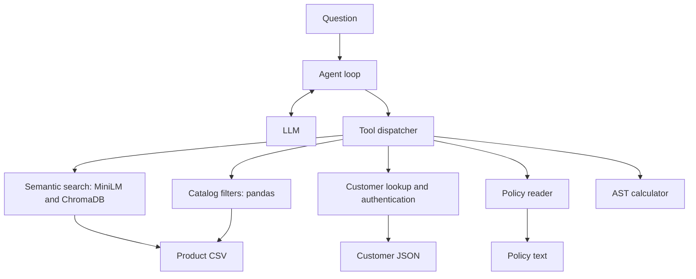

# Agentic RAG Support Agent

A Python customer-support agent for a retail store. It combines semantic product search
with catalog filters and uses tools to answer account questions, read store policies
and perform calculations.

Built during a university course on LLMs for software engineering. The included store
data is fictional: 10 products, 5 customers and a short set of policies.

## Getting started

Requires Python 3.11 or 3.12.

```bash
git clone https://github.com/halfonsimon/agentic-rag-support-agent.git
cd agentic-rag-support-agent
python3.12 -m venv .venv
.venv/bin/python -m pip install -r requirements-dev.txt -e .
cp .env.example .env
```

Set `OPENAI_API_KEY` and `OPENAI_MODEL` in `.env`. Load the configuration, then ask a question:

```bash
set -a
source .env
set +a

.venv/bin/python -m support_agent 'Show available Trailguard products priced at $60 or less.'
```

For Azure, also set `AZURE_OPENAI_ENDPOINT` to your OpenAI-compatible v1 base URL and use
its deployment name as `OPENAI_MODEL`. See the [Azure v1 API documentation](https://learn.microsoft.com/en-us/azure/ai-foundry/openai/api-version-lifecycle?tabs=key).
Configuration comes from environment variables; the application does not load `.env`
automatically. The example file contains no credentials, and `.env` is ignored by Git.

You can also call the agent from Python:

```python
from support_agent import answer_question

print(answer_question("Recommend one gentle soap and tell me its price."))
```

## Architecture

The model chooses a tool, receives its result and either calls another tool or returns
an answer. The agent manages the conversation, tool dispatch, retry logic and call budgets.



| Tool | Purpose |
| --- | --- |
| `search_products` | Retrieve products by meaning from the vector index. |
| `filter_products` | Filter by sale price, brand, category, availability, sale status or product name. |
| `get_customer` | Look up a customer's name and interests for gift recommendations. |
| `authenticate` | Check demo credentials and return allowed account fields. |
| `read_policies` | Read the configured store policies. |
| `calculator` | Evaluate a restricted numeric expression. |

### Implementation notes

- **Plain tool-calling loop.** The orchestration fits in one module, so messages, retries
  and budgets are easy to follow. LangGraph would be useful for a larger workflow needing
  checkpoints or resumable execution.
- **Semantic search and structured filters.** MiniLM embeddings help with requests such as
  “gear for snowboarding.” Filters handle price and stock constraints; brand, category and
  name matching use case-insensitive literal substrings. The model combines the results.
- **Lazy loading.** Data and the in-memory Chroma index are cached per process. Importing
  the package does not load data or build embeddings. The first semantic search may download
  the embedding model and builds the index from product names and descriptions.
- **Customer privacy.** `get_customer` returns only names and interests. Private account
  fields are returned by `authenticate` after checking credentials; neither tool returns
  the stored password. This is a demo authentication flow, without sessions or lockout.
- **AST calculator.** Arithmetic uses a numeric AST whitelist, with expression length,
  node-count, exponent and result-size limits. Arbitrary function calls and attribute access
  are rejected.
- **Bounded execution.** Each question allows up to 15 model request attempts, including
  retries, and 15 tool executions. Requests have a 30-second timeout. Rate limits trigger
  exponential backoff; content-filter retries are capped at three. SDK retries are disabled
  so all attempts count toward the same budget.
- **Tool errors.** Exceptions become JSON tool responses that the model can use to recover.
  The dispatcher reports exception types without echoing potentially sensitive details.

More detail on the prompts and tool schemas is in [the design notes](docs/design-notes.md).

## Data

The default files are in `sample_data/`. Matching copies are bundled with the Python
package so installed tools also work outside the checkout. All customer records and
credentials are fictional; use these demo accounts only.

To use a larger catalog, download [Walmart Product Data 2019 from Kaggle](https://www.kaggle.com/datasets/promptcloud/walmart-product-data-2019)
and map its columns to this schema:

| Column | Usage |
| --- | --- |
| `Uniq Id` | Identifier for the vector index. |
| `Product Name`, `Description` | Search text and product descriptions. |
| `List Price`, `Sale Price` | Pricing and discount checks; price filters use `Sale Price`. |
| `Brand`, `Category` | Catalog attribute filters. |
| `Available` | Stock status, such as `true`/`false` or `in stock`/`out of stock`. |

Keep external data in the ignored `local_data/` directory and check its license before use.
Extra columns are ignored. The following environment variables override the defaults:

| Variable | Default |
| --- | --- |
| `SUPPORT_PRODUCT_CSV` | `sample_data/catalog.csv` |
| `SUPPORT_CUSTOMERS_JSON` | `sample_data/customers.json` |
| `SUPPORT_POLICIES_TXT` | `sample_data/policies.txt` |
| `SUPPORT_EMBED_MODEL` | `all-MiniLM-L6-v2` |

Restart the process after changing data files. Missing or empty policy files fall back
to the bundled demo policies; catalog and customer loading errors are reported as tool errors.

## Development

Run linting, formatting checks and tests:

```bash
.venv/bin/ruff check .
.venv/bin/ruff format --check .
.venv/bin/python -m pytest -q
```

The 41 tests run without API keys or model downloads. They cover calculator acceptance
and rejection, product filters, customer-field redaction, authentication, lazy indexing,
retry limits and tool-error recovery. Agent tests use a fake LLM client. GitHub Actions
runs Ruff and pytest on pushes and pull requests.

The live eval script has eight sample questions with expected answers:

```bash
.venv/bin/python evals/run_evals.py --list
.venv/bin/python evals/run_evals.py
```

It skips when `OPENAI_API_KEY` is unset and requires `OPENAI_MODEL` when running. Live evals
use the sample dataset, make paid model calls and check expected substrings in the answers.
They provide a small smoke evaluation; broader answer quality has not been measured.

## Limitations and next steps

- Retrieval uses nearest neighbors without a reranker or relevance threshold. Add reranking
  and a larger eval set to measure relevance and unsupported answers.
- Authentication uses plaintext demo credentials, and credentials supplied in a question
  enter the model transcript. A real deployment needs an identity provider and authenticated
  session context, with authorization enforced inside every account-sensitive tool.
- The model follows policy and recommendation rules through prompts. Final answers are not
  checked automatically, and catalog or policy text can contain prompt injection.
- Add tracing for tool calls, retrieval results and timing, with credential redaction.
- Data and indexes are held in memory. Requests are independent, with no conversation
  persistence or purchase execution.
- Runtime dependencies are pinned, but transitive dependencies are not locked. Dependency
  updates need compatibility checks; the current stack emits deprecation and telemetry
  compatibility warnings.
