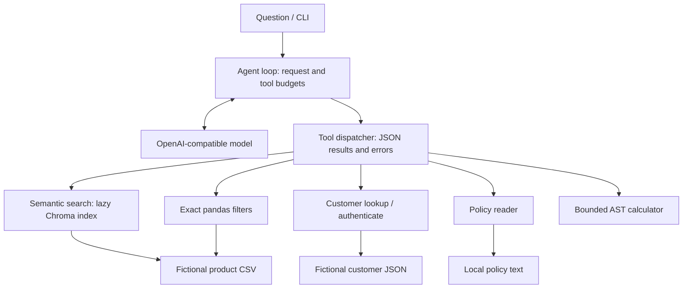

# Support Agent

A customer-support agent that answers product and account questions with six tools.
Semantic retrieval finds products by meaning; exact filters enforce catalog constraints.
A bounded model loop combines tools and returns grounded answers with fictional demo data.

Built during a university course on LLMs for software engineering. This portfolio version
contains only the original agent implementation and design notes, plus new demo data,
tests and project tooling. The repository is prepared locally for review; no remote is configured.



## Design decisions

| Choice | Benefit | Trade-off |
| --- | --- | --- |
| Raw tool-calling loop instead of LangGraph | The messages, tool results, retries and counters are directly inspectable. | No durable checkpoints, graph visualization or resumable workflows. |
| RAG plus exact filters | MiniLM embeddings retrieve meaning; pandas handles price, availability and literal attribute substrings. | Semantic rank alone cannot guarantee a hard constraint; the model must combine results correctly. |
| Authentication in tools | `authenticate` checks credentials and returns an explicit allowlist; `get_customer` exposes only names and gift interests. | Demo authentication lacks sessions, password hashing, lockout and rate limiting. |
| Numeric AST calculator | Allows numeric operators and `round`, `abs`, `min`, `max` without `eval` or `exec`. | Restricted language; expressions are capped at 1000 characters, 100 AST nodes, exponent magnitude 100 and result magnitude 1e100. |
| Limits and retries | At most 15 model request attempts, including retries, and 15 tool executions per question; 429 errors back off for 2, 4, 8 seconds. | A request can stop before the model finishes; content-filter retries are also capped at three. |
| Lazy data and index loading | Importing and exact filtering do not build embeddings or call a model. | The first semantic query downloads the embedding model if absent and builds an in-memory index; each process rebuilds it. |

The safety changes approved for this version restrict unauthenticated lookup, bound calculator
work and count every model attempt against a strict limit. There is no additional final model
request after exhaustion. Tool failures become JSON error responses so the model can recover;
exception details are omitted because they can contain sensitive arguments. Original sale-price
filtering, case-insensitive literal substrings, output fields, tool names and store rules remain.

## Run

Use Python **3.11 or 3.12**; the retained dependency versions do not target newer Python releases.

```bash
python3.12 -m venv .venv
source .venv/bin/activate
python -m pip install -r requirements-dev.txt -e .
cp .env.example .env
```

Edit `.env` with your key and model or Azure deployment name, then export it into your shell:

```bash
set -a
source .env
set +a
python -m support_agent "Which available scales cost at most 40 dollars?"
```

`OPENAI_API_KEY` and `OPENAI_MODEL` are required for model calls and have no default values.
Leave `AZURE_OPENAI_ENDPOINT` empty for the OpenAI service. For Azure, set it to your complete
OpenAI-compatible v1 base URL and use the deployment name as `OPENAI_MODEL`; obtain these
values from your account rather than committing them. See [Microsoft's v1 endpoint documentation](https://learn.microsoft.com/en-us/azure/ai-foundry/openai/api-version-lifecycle?tabs=key).
The SDK's automatic retries are disabled so the loop owns the budget; each request has a
30-second timeout. `.env` is ignored and never loaded implicitly by the library.

```python
from support_agent import answer_question

answer = answer_question("Recommend one gentle soap and give its sale price.")
print(answer)
```

The root `sample_data/` holds 10 invented products, 5 fictional customers and short demo
policies. The installed package bundles matching copies for use outside the checkout.
Demo customer emails use `example.com`; their deliberately public demo credentials must
never be reused for a real account. No real customer records are included.

## Use a larger product catalog

Download the full [Walmart Product Data 2019 snapshot on Kaggle](https://www.kaggle.com/datasets/promptcloud/walmart-product-data-2019),
review its own license and terms, and keep it under ignored `local_data/`. Catalog snapshots
vary, so select product data rather than a weekly sales/forecasting dataset and map its
columns to the following schema before use. No downloader or third-party dataset is bundled.

| CSV column | Meaning |
| --- | --- |
| `Uniq Id` | Stable identifier; blank or duplicate identifiers are replaced for indexing. |
| `Product Name`, `Description` | Embedded product text and tool descriptions. |
| `List Price`, `Sale Price` | Numeric prices or currency strings; filtering uses Sale Price. |
| `Brand`, `Category` | Case-insensitive literal substring filters. |
| `Available` | `true`/`false`, yes/no, or in-stock/out-of-stock text. |

Optional extra columns, such as `Gtin`, are ignored. Preserve all rows you are authorized to
use; the loader reads the full configured CSV. Set `SUPPORT_PRODUCT_CSV` to its path in `.env`
and restart the process after changing a data file, because loaders cache data in memory.
`SUPPORT_CUSTOMERS_JSON`, `SUPPORT_POLICIES_TXT` and `SUPPORT_EMBED_MODEL` similarly override
local files and the embedding model. Missing or empty policy files fall back to the demo
policies; catalog/customer load failures are returned as tool errors.

## Test and evaluate

```bash
ruff check .
ruff format --check .
pytest -q
python evals/run_evals.py --list
python evals/run_evals.py
```

Unit tests use real sample records and a scripted fake model client, covering numeric
acceptance/rejection, exact filters, private-field omission, strict request/tool caps,
bounded retries and model-visible tool errors. Retrieval tests fake the index to avoid a
model download. CI installs dependencies, runs Ruff and pytest without secrets.

The live eval script contains eight sample questions and expected answers. It skips without
`OPENAI_API_KEY` and also requires `OPENAI_MODEL`; it always selects the fictional sample
files. With credentials it makes paid model calls and may download the embedding model.
Its substring checks are a smoke evaluation, not a rigorous quality or security score.

## Known limitations and next steps

- Add a reranker, a larger eval set and explicit relevance thresholds; nearest neighbors can
  be unrelated when no item satisfies a semantic query.
- Enforce authorization inside every account-sensitive tool using authenticated session
  context. Current lookup redacts private fields, but gift interests are public and the model
  still decides when authentication is needed for personalization.
- Replace fictional plaintext credentials with a real identity provider. Credentials in a
  user's question currently enter the model transcript; use only demo accounts.
- Add tracing with credential redaction, per-tool timing and retrieval diagnostics.
- Catalog facts and policy text can contain prompt injection; add structured trust boundaries.
  Missing/unknown availability is permissive as in the original implementation.
- These pinned versions retain the initial runtime behavior; dependency modernization and a
  reproducible transitive lockfile should follow compatibility and security review.
- Requests are independent; there is no conversation persistence, purchase execution or
  durable index. The loop is bounded but does not validate every final product claim.

Before publishing, review every file and local commit, rotate the credential found in the
original source, confirm the MIT licensing of your own work, and create a **private** repository
manually. Keep external data and configuration out of Git.

## License

[MIT](LICENSE) applies to this code and the invented demo data. External datasets retain their
own licenses. The original design notes are adapted in [docs/design-notes.md](docs/design-notes.md).
